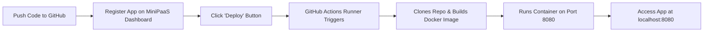

# MiniPaaS Application Specification & Deployment Guide

This guide explains **everything an application must contain** to be registered, built, and deployed on **MiniPaaS**, using the standard `minipaas-test` structure.

---

## 1. Directory Structure

For any app deployed on MiniPaaS, the root of your Git repository should have the following minimum structure:

```text
minipaas-test/
├── Dockerfile           # CRITICAL: MiniPaaS runner uses this to build your container
├── package.json         # Defines dependencies and the start script
├── server.js            # Main application entry point (Express web server)
├── .dockerignore        # Prevents bloat (node_modules, .git) during docker build
└── README.md            # Documentation / notes
```

---

## 2. File-by-File Implementation

### ① `server.js` (Application Entry Point)

Your server must listen on **port `80`** (or respect the `PORT` environment variable) and bind to `0.0.0.0`. It should also expose a `/health` endpoint for monitoring.

```javascript
const express = require('express');
const app = express();

// MiniPaaS forwards traffic to port 80 inside the container by default
const PORT = process.env.PORT || 80;

// Middleware for JSON parsing
app.use(express.json());

// 1. Root route
app.get('/', (req, res) => {
  res.send('Hello! MiniPaaS deployment is working successfully!');
});

// 2. Health check route (used by monitoring systems)
app.get('/health', (req, res) => {
  res.status(200).json({
    status: 'healthy',
    uptime: process.uptime(),
    timestamp: new Date().toISOString()
  });
});

// 3. Start server (must listen on 0.0.0.0)
app.listen(PORT, '0.0.0.0', () => {
  console.log(`Server is running on port ${PORT}`);
});
```

---

### ② `Dockerfile` (Container Specification)

The MiniPaaS runner executes `docker build -t ... .` directly from the repository root. Your Dockerfile packages and runs the app:

```dockerfile
# 1. Use an official lightweight Node image
FROM node:20-alpine

# 2. Set the working directory inside the container
WORKDIR /app

# 3. Copy package files first to leverage Docker layer caching
COPY package*.json ./

# 4. Install production dependencies
RUN npm install --omit=dev

# 5. Copy the rest of the application files
COPY . .

# 6. Expose port 80
EXPOSE 80

# 7. Set default environment variable
ENV PORT=80
ENV NODE_ENV=production

# 8. Command to start the application
CMD ["npm", "start"]
```

---

### ③ `package.json`

Define the dependencies and the `start` script:

```json
{
  "name": "minipaas-test",
  "version": "1.0.0",
  "description": "Sample application for MiniPaaS",
  "main": "server.js",
  "scripts": {
    "start": "node server.js"
  },
  "dependencies": {
    "express": "^4.19.2"
  }
}
```

---

### ④ `.dockerignore`

Add a `.dockerignore` file in the root to ensure local `node_modules` or Git metadata are not sent to the Docker daemon during build:

```text
node_modules
npm-debug.log
.git
.gitignore
.env
```

---

## 3. MiniPaaS Technical Requirements Checklist

| Requirement | Specification | Why It Matters |
|---|---|---|
| **Container Port** | **`80`** (or `process.env.PORT`) | The runner executes `docker run -p 8080:80`. If your app listens on `3000` or `5000` instead of `80`, external requests will not connect. |
| **Host Binding** | `0.0.0.0` | Binding to `localhost` or `127.0.0.1` inside Docker prevents traffic from outside the container from reaching the server. |
| **Dockerfile Location** | Root directory (`./Dockerfile`) | The runner builds using `docker build -t minipaas-<appId>:<depId> .` at the root of the cloned repo. |
| **Health Check Route** | `GET /health` returning `200 OK` | The MiniPaaS background monitor inspects running containers and health status. |
| **Foreground Process** | `node server.js` | The container command must stay in the foreground (do NOT use daemon managers like PM2 in detached mode). |

---

## 4. Step-by-Step Deployment Flow



### Step 1: Push Code to GitHub
Ensure your repository (e.g., `https://github.com/<username>/minipaas-test`) has the files committed and pushed to `main`.

### Step 2: Register Application in MiniPaaS
1. Open the MiniPaaS Dashboard (`http://localhost:5173`).
2. Go to **Applications** and click **Register Application**.
3. Fill in the modal:
   - **Name**: `MiniPaaS Test`
   - **Slug**: `minipaas-test`
   - **Repository URL**: `https://github.com/<username>/minipaas-test`
   - **Branch**: `main`
4. Click **Create Application**.

### Step 3: Trigger Deployment
1. Click into the newly registered application.
2. Click **Deploy**.
3. Status changes: `queued` ➔ `building` ➔ `success`.
4. Check **System Logs** to see live build and deployment logs.

### Step 4: Verify the Application
Once the deployment status reaches **Success**, visit:
- **Application**: `http://localhost:8080`
- **Health Check**: `http://localhost:8080/health`

---

## 5. Other Languages (Python / Flask / FastAPI)

If you want to deploy a Python app instead of Node.js:

### `app.py`
```python
from flask import Flask, jsonify
import os

app = Flask(__name__)
PORT = int(os.environ.get("PORT", 80))

@app.route("/")
def index():
    return "Hello from Python on MiniPaaS!"

@app.route("/health")
def health():
    return jsonify(status="healthy")

if __name__ == "__main__":
    app.run(host="0.0.0.0", port=PORT)
```

### `Dockerfile`
```dockerfile
FROM python:3.11-slim
WORKDIR /app
COPY requirements.txt .
RUN pip install --no-cache-dir -r requirements.txt
COPY . .
EXPOSE 80
ENV PORT=80
CMD ["python", "app.py"]
```
