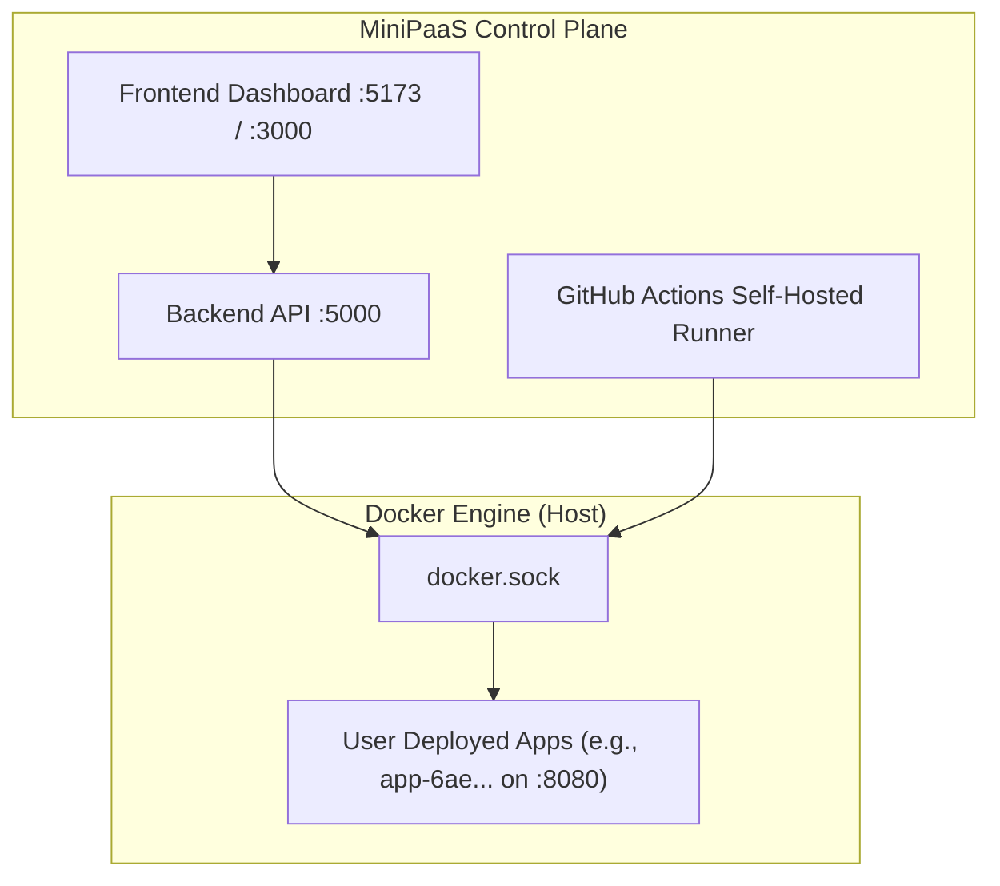

# MiniPaaS System Startup Guide

This document explains **how the MiniPaaS system starts**, the difference between the **MiniPaaS Control Plane** and **Deployed Application Containers**, and the exact sequence required to bring up the entire environment.

---

## 💡 Quick Answer: Does starting Backend & Frontend start everything?

**No, not automatically.** Here is why:

MiniPaaS has **two separate layers**:



1. **The Control Plane (Dashboard & Backend)**:
   Starting the backend and frontend only starts the **control interface**. The backend queries Docker via the Docker socket to read container stats and health, but it **does not automatically spawn or rebuild your user apps on startup**.
2. **The Deployed Application Containers (e.g. `minipaas-test` on `:8080`)**:
   These run directly on the **Docker Engine**.
   - If Docker Desktop was restarted, previously created containers may be in an `exited` or `stopped` state.
   - To bring a deployed app back up, you can either click **"Trigger Deployment"** from the dashboard or run `docker start <containerName>`.
3. **The GitHub Actions Runner (`E:\actions-runner`)**:
   Must be running in order for new deployments to be built and launched when you click **"Deploy"** in the dashboard.

---

## 🚀 The 4-Step Startup Sequence

To run the complete system reliably, start components in this exact order:

```
[1. Docker Desktop] ──► [2. Self-Hosted Runner] ──► [3. MiniPaaS Backend & Frontend] ──► [4. Deploy / Start Apps]
```

---

### Step 1: Start Docker Desktop (Prerequisite)

Before starting MiniPaaS, ensure **Docker Desktop** is running on your machine:
- Open Docker Desktop from the Start menu.
- Verify in your terminal:
  ```powershell
  docker ps
  ```
  *(If this command succeeds without errors, Docker is ready).*

---

### Step 2: Start the GitHub Actions Runner

MiniPaaS dispatches builds to a self-hosted GitHub Actions runner located on your machine at `E:\actions-runner`.

1. Open a new PowerShell terminal.
2. Run:
   ```powershell
   cd E:\actions-runner
   .\run.cmd
   ```
3. You should see:
   ```text
   √ Connected to GitHub
   Listening for Jobs
   ```
> **Tip**: Keep this terminal open in the background so it can receive deployment jobs.

---

### Step 3: Start MiniPaaS Platform (Choose Method A or B)

You have two options to run MiniPaaS itself:

#### Option A: Docker Compose (Recommended for Production / Clean Run)
From `e:\CLoud Project`:
```powershell
docker compose up -d
```
This automatically starts:
- `minipaas-backend` on port `5000`
- `minipaas-frontend` on port `3000`

#### Option B: Local Development Mode (With Hot Reloading)
If you are developing or modifying the dashboard:

**Terminal 1 — Backend:**
```powershell
cd "e:\CLoud Project\apps\backend"
npm run dev
```
*(Runs on `http://localhost:5000`)*

**Terminal 2 — Frontend:**
```powershell
cd "e:\CLoud Project\apps\frontend"
npm run dev
```
*(Runs on `http://localhost:5173`)*

---

### Step 4: Deployed Application Containers

Once MiniPaaS is running, how do your user apps come up?

#### Scenario A: You deployed before and want to resume the container
If the container was already created on your machine, check its status:
```powershell
docker ps -a
```
If it is in `Exited` status, simply start it:
```powershell
docker start app-<your-application-id>
```

#### Scenario B: Deploying fresh or triggering an update
1. Go to your browser: **`http://localhost:5173`** (or `:3000` if using Docker Compose).
2. Navigate to **Applications** ➔ Select your application.
3. Click **"Trigger Deployment"**.
4. The system will:
   - Queue the deployment.
   - Dispatch the job to your running `actions-runner`.
   - Build the Docker image from your repo's `Dockerfile`.
   - Spin up the container on port `8080`.
   - Report `Success` back to the dashboard.

---

## 📋 Startup Status Verification Checklist

| Service | Port / Process | How to Verify | Expected Output |
|---|---|---|---|
| **Docker Daemon** | `dockerd` | `docker info` | Shows Docker version and running status |
| **GitHub Runner** | `Runner.Listener` | `Get-Process Runner.Listener` | Process exists and listening for jobs |
| **MiniPaaS Backend** | `:5000` | `curl http://localhost:5000/health` | `{"status":"ok"}` |
| **MiniPaaS Frontend** | `:5173` or `:3000` | Open browser at URL | Dashboard renders with active services |
| **Deployed App** | `:8080` | `curl http://localhost:8080/health` | `{"status":"healthy"}` |

---

## 🛠️ Automated 1-Click Startup

A launcher script is available in both the project root and `scripts/`:

### How to Run:
**Option 1 (PowerShell from root):**
```powershell
.\start-all.ps1
```

**Option 2 (PowerShell from `scripts/` directory):**
```powershell
.\start-all.ps1
```

**Option 3 (Double-click or run from CMD):**
```cmd
start.bat
```

---

### What `start-all.ps1` Does:
1. Resolves the project root directory automatically.
2. Verifies Docker Engine is up and running.
3. Checks if the GitHub Actions runner (`Runner.Listener`) is active; if not, automatically launches `E:\actions-runner\run.cmd` in a background window.
4. Starts the MiniPaaS backend and frontend containers with `docker compose up -d`.
